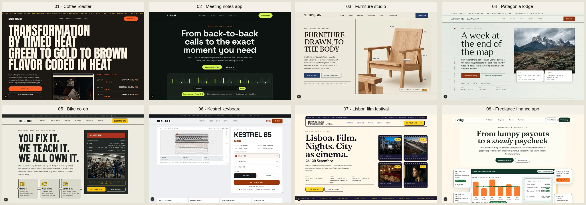

# Benchmark results

Every build below was made by Bloom from a single prompt, with no follow-up messages, by `benchmark/bench.mjs`. Each one passed Bloom's own review of the desktop and mobile captures before it was saved.

## Bloom

| # | Prompt | Site | Time | Images | Console errors | Mobile overflow |
| --- | --- | --- | --- | --- | --- | --- |
| [01](bloom/01-coffee-roaster) | a website for a small-batch coffee roaster in Portland, Oregon | Kinship Roasters | 12m 47s | 4/4 | 0 | none |
| [02](bloom/02-meeting-notes) | a landing page for an AI meeting notes app that turns calls into searchable notes | Signal | 6m 15s | none used | 0 | none |
| [03](bloom/03-furniture-studio) | a portfolio website for an independent furniture designer and maker | Tightjoin | 11m 33s | 20/20 | 0 | none |
| [04](bloom/04-patagonia-lodge) | a website for a boutique wilderness lodge in Patagonia, Chile | Estancia 51S | 16m 38s | 9/9 | 0 | none |
| [05](bloom/05-bike-coop) | a website for a community-run bicycle repair co-op in Minneapolis | The Stand | 10m 41s | 4/4 | 0 | none |
| [06](bloom/06-kestrel-keyboard) | a product page for a mechanical keyboard called the Kestrel 65 | Kestrel 65 | 11m 29s | 5/5 | 0 | none |
| [07](bloom/07-lisbon-film) | a website for an independent film festival in Lisbon | Festa do Filme Independente | 11m 27s | 6/6 | 0 | none |
| [08](bloom/08-freelance-finance) | a website for a personal finance app for freelancers | Ledgr | 15m 30s | none used | 0 | none |
| [09](bloom/09-bakery-preorders) | a landing page for a neighbourhood bakery that takes pre-orders for weekend bread | The Weekend Bake | 9m 16s | 21/21 | 0 | none |

Prompts 01 to 08 are the fixed benchmark set in `benchmark/prompts.mjs`; 09 is an extra run. Each folder holds full-page `desktop.png` (1440 px) and `mobile.png` (390 px) captures, `metrics.json`, the generation `run.log` and the `DESIGN.md` the design director wrote.

These numbers show that every build works. They do not measure design quality: some pages include specifics the prompt never gave, such as prices or lot numbers, and judging how good they look needs people.

## Comparison with Lovable and v0

`compare/` holds a blind comparison on prompts 01 to 08. `compare/PROMPTS.md` lists the prompts and how to run them in the other tools; once their sites are captured, reviewers score shuffled, unlabelled options and the scores are tallied into `compare/RESULTS.md`. See [`benchmark/README.md`](../benchmark/README.md#comparing-with-other-builders) for the steps. No scores have been collected yet.
